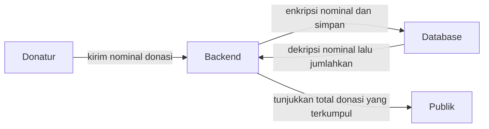
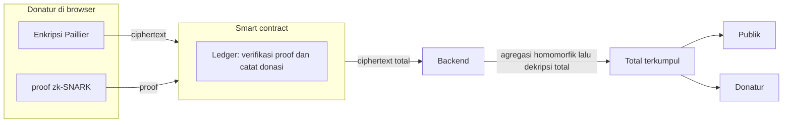
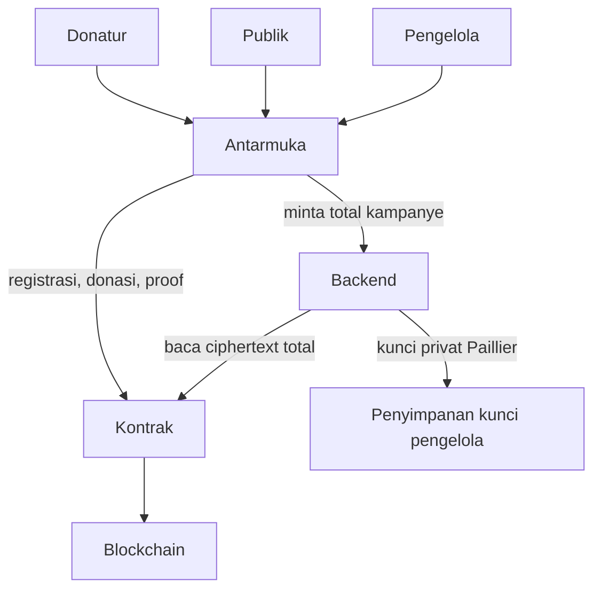
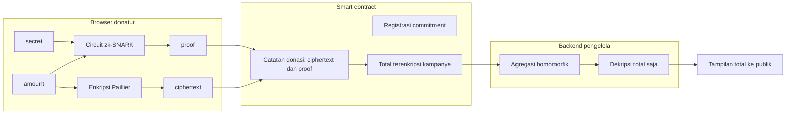

# Perancangan Sistem Donasi Transparan

Berbasis blockchain, enkripsi homomorfik Paillier, dan zk-SNARK.

Dokumen ini adalah spesifikasi penelitian yang akan dibangun.

## 1. Analisis masalah

### Masalah yang diangkat

Sistem donasi digital yang ada menyimpan nominal dengan enkripsi biasa (AES). Angka itu aman saat tersimpan, tetapi tidak bisa dijumlahkan dalam keadaan terenkripsi. Untuk menampilkan total, backend harus mendekripsi nominal satu per satu. Jika basis data atau kunci bocor, nominal tiap donatur ikut terbuka.

Model sistem yang berjalan sekarang:

Donatur mengirim nominal mentah. Backend mengenkripsi untuk disimpan, lalu harus mendekripsi tiap nominal sebelum bisa menjumlahkan. Publik hanya menerima total.

Masalah yang ditangani:

- Pencatatan dan pelaporan total kurang transparan.
- Tidak ada jaminan donasi benar-benar masuk ke sistem.
- Nama, email, dan nominal rawan bocor.
- Privasi donatur dan transparansi total sulit dipenuhi bersamaan.
- Tidak ada bukti transaksi tanpa membuka data.
- Tidak ada cara menghitung total tanpa membuka data mentah.

### Pendekatan

Model sistem yang diusulkan:

1. Donatur, di browser, mengenkripsi nominal dengan Paillier dan membuat proof zk-SNARK.
2. Smart contract memeriksa proof dan status registrasi, lalu mencatat donasi di ledger.
3. Backend mengambil ciphertext total dari blockchain dan mendekripsinya.
4. Publik dan donatur melihat total terkumpul, bukan nominal masing-masing.

Riwayat donasi menampilkan penanda `ENC` dan pengenal transaksi, bukan angka 50.000 pada baris riwayat. Total kampanye tetap muncul sebagai rupiah.

### Sirkuit

| Bagian | Isi |
|---|---|
| Input privat, tetap di browser | `secret`, `amount` |
| Input publik | `commitment` |
| Komponen | Poseidon atas `secret`, dan pemeriksaan `amount > 0` |
| Keluaran | proof Groth16 `(A, B, C)` |
| Alat | Circom 2.0.0, `circuits/setup.sh`, snarkjs |
| Setup | Groth16, kurva bn128, Powers of Tau `pot12` |
| Artefak | `identity.r1cs`, witness generator, proving key, `verification_key.json` |

### Batas yang harus diakui

Jaminan yang ditargetkan:

- Nominal individual tidak ditulis sebagai plaintext di riwayat.
- Proof menunjukkan donatur tahu `secret` yang cocok dengan `commitment`, dan `amount` lebih dari nol.
- Total kampanye bisa ditampilkan setelah agregasi.

Yang tidak dijamin oleh sirkuit dasar (Poseidon dan `amount > 0`) saja:

- Proof tidak mengikat ciphertext Paillier ke `amount`. Donatur bisa mengirim bukti yang sah untuk suatu amount, lalu menyimpan ciphertext untuk angka lain. Penelitian ini mencatat celah itu dan menutupnya di spesifikasi bawah, karena tanpa ikatan itu transparansi total tidak bisa dipercaya.
- Alamat pengirim di blockchain tetap terlihat. Privasi yang ditargetkan adalah nominal, bukan anonimitas identitas rantai.
- Pemegang kunci privat Paillier bisa mendekripsi setiap ciphertext, bukan hanya totalnya. Privasi terhadap publik tidak sama dengan privasi terhadap pemegang kunci.

## 2. Tujuan penelitian ini

Membangun dan menguji purwarupa dengan spesifikasi yang cukup ketat untuk diulang.

Tujuan yang diukur:

1. Donatur mengenkripsi nominal di browser dan mengirim ciphertext beserta proof ke kontrak.
2. Kontrak menolak proof yang tidak sah atau identitas yang belum terdaftar, dan menyimpan donasi tanpa field nominal plaintext.
3. Dua donasi atau lebih pada satu kampanye bisa dijumlahkan menjadi satu ciphertext, lalu hanya totalnya yang didekripsi untuk tampilan publik.
4. Riwayat menampilkan status terenkripsi, bukan nominal tiap donasi.
5. Celah "proof tidak mengikat ciphertext" ditutup: proof hanya sah jika ciphertext benar-benar enkripsi dari `amount` yang dirahasiakan.

Di luar sasaran: pembayaran fiat sungguhan, anonimitas ala mixer, dan resistant terhadap pemegang kunci privat.

## 3. Aktor

| Aktor | Peran |
|---|---|
| Donatur | Mendaftar identitas, memilih kampanye, memasukkan nominal dan secret, membuat ciphertext dan proof di browser |
| Publik | Melihat daftar kampanye, status tersalurkan, dan total terkumpul |
| Pengelola | Membuat kampanye, menandai dana sudah ditransfer, memegang kunci privat Paillier |
| Backend | Membaca ciphertext dari rantai, mengalikan ciphertext (penjumlahan Paillier), mendekripsi hanya total, menyajikan API ke antarmuka |
| Smart contract | Menyimpan registrasi, kampanye, ciphertext, dan proof yang sudah lolos verifikasi |

Secret adalah kata sandi yang hanya diketahui donatur. Commitment-nya bersifat publik dan menjadi identitas yang dikenali kontrak.

## 4. Diagram sistem

Komponen dan siapa yang memakainya:

Aliran data di dalam donasi:

Tiga zona kepercayaan:

- Browser memegang `secret`, `amount`, dan bilangan acak Paillier. Tidak ada yang dikirim dalam bentuk itu.
- Kontrak memegang data publik: commitment, ciphertext, proof, dan status kampanye. Kontrak tidak punya kunci dekripsi.
- Backend memegang kunci privat Paillier. Backend boleh melihat nominal jika ia mendekripsi ciphertext satu per satu. Spesifikasi ini melarang endpoint yang melakukan itu. Endpoint publik hanya mengembalikan dekripsi dari ciphertext total.

## 5. Skenario

### S1. Menyiapkan sistem

Pengelola membuat pasangan kunci Paillier dan menjalankan trusted setup Groth16. Kunci publik `(n, g)` dan verification key ditanam ke kontrak. Kunci privat tinggal di backend.

### S2. Melihat kampanye

Publik membuka daftar kampanye tanpa masuk.

Contoh kampanye:

| Kampanye | Target | Kondisi awal |
|---|---|---|
| Bantu Sari pulih setelah operasi | Rp 5.000.000 | Sudah tersalurkan, 3 donasi, tanggal penyaluran tercatat |
| Bantu Raka kembali bersekolah | Rp 2.000.000 | Belum ada donasi, total ditampilkan sebagai belum dihitung |

"Belum dihitung" berarti ciphertext total masih enkripsi nol, atau belum ada donasi. Bukan berarti nominal disembunyikan dari publik selamanya. Setelah ada donasi, yang tampil adalah total.

### S3. Mendaftarkan identitas

Donatur memasukkan secret. Browser menghitung `commitment = Poseidon(secret)` dan mengirim commitment ke kontrak. Kontrak menyimpan commitment satu kali. Secret tidak pernah dikirim.

Antarmuka menampilkan "Identitas terdaftar. Siap berdonasi." setelah commitment ada di rantai dan secret masih tersimpan di sesi browser.

### S4. Berdonasi

Donatur memilih Bantu Raka kembali bersekolah, mengisi Rp 50.000, dan mengisi secret yang sama.

Browser, berurutan:

1. Mengenkripsi 50000 dengan Paillier menjadi ciphertext.
2. Membuat witness: secret, amount 50000, randomness enkripsi, dan commitment.
3. Membuat proof dengan snarkjs.
4. Mengirim transaksi: identitas commitment, indeks kampanye, ciphertext, proof.
5. Menunggu konfirmasi.

Kontrak menerima transaksi hanya jika commitment terdaftar dan verifier Groth16 mengembalikan sah. Layar sukses menampilkan pengenal transaksi, misalnya bentuk `0xa337…`, dan kalimat bahwa donasi tercatat dalam bentuk terenkripsi.

### S5. Melihat hasil tanpa membuka nominal orang lain

Setelah satu donasi 50.000:

- Penghitung donasi naik.
- Total kampanye Raka menjadi Rp 50.000, karena total itulah yang didekripsi.
- Baris riwayat menampilkan `ENC` dan pengenal transaksi, tanpa angka 50.000.

Setelah donasi kedua, misalnya 20.000 dari donatur lain:

- Total menjadi Rp 70.000.
- Riwayat bertambah satu baris `ENC`.
- Antarmuka tidak punya kolom yang menunjukkan 50.000 dan 20.000.

### S6. Menandai tersalurkan

Pengelola menandai kampanye selesai setelah dana dianggap sudah ditransfer di luar rantai. Kontrak menyimpan status `Tersalurkan`, waktu, dan total pada saat itu. Contoh kampanye Sari memakai tanggal 27 Juli 2026 dan keterangan bahwa dana sudah ditransfer. Purwarupa ini tidak memindahkan rupiah; ia hanya mengunci status dan total yang sudah tercatat.

## 6. Spesifikasi kriptografi

### 6.1 Paillier

Dipakai karena penjumlahan bisa dilakukan pada ciphertext.

- Kunci publik `(n, g)`, kunci privat `(λ, μ)`.
- Enkripsi di browser: `c = g^m * r^n mod n^2`, dengan `m` nominal dalam rupiah bulat dan `r` acak di antara 1 dan `n-1` yang koprima terhadap `n`.
- Penjumlahan: `c_total = c1 * c2 mod n^2`, yang merupakan enkripsi dari `m1 + m2`.
- Perkalian dengan bilangan biasa tidak diperlukan untuk donasi.
- Panjang modulus untuk purwarupa: 2048 bit. Lebih pendek hanya boleh untuk uji otomatis di mesin lokal, dan harus ditandai sebagai parameter uji, bukan parameter demo.

Nominal dibatasi 1 sampai 1.000.000.000 rupiah agar muat di sirkuit dan tetap masuk akal untuk donasi. Nol ditolak.

Ciphertext disimpan sebagai dua limb 128-byte (atau deretan `bytes32` yang panjangnya tetap), karena `c` berada di modulus `n^2`.

### 6.2 zk-SNARK

Sistem bukti: Groth16 pada bn128, agar verifier Solidity bisa memakai precompile Ethereum. Setup: Powers of Tau `pot12`, cukup untuk sirkuit kecil ini. File setup: `circuits/setup.sh`, keluaran `identity.r1cs`, proving key, dan `verification_key.json`.

Input publik:

- `commitment`
- limb ciphertext yang sama dengan yang dikirim ke kontrak
- `n` dan `g` Paillier, sebagai konstanta sirkuit hasil setup, bukan input donatur

Input privat:

- `secret`
- `amount`
- `r`, randomness Paillier

Batasan yang wajib lolos:

1. `Poseidon(secret) === commitment`
2. `1 <= amount <= 1000000000`
3. `c = g^amount * r^n mod n^2`, dengan `c` yang sama dengan ciphertext publik

Butir 3 menutup kemungkinan proof dan ciphertext dipasangkan secara bohong. Jika sirkuit penuh terlalu berat untuk putaran pertama, implementasi boleh memecahnya menjadi dua tahap yang keduanya tetap wajib sebelum purwarupa disebut selesai:

- Tahap A: Poseidon dan `amount > 0`.
- Tahap B: batasan enkripsi Paillier di atas. Purwarupa belum disebut selesai sebelum tahap B lolos uji.

`amount` tidak boleh menjadi sinyal publik. Kalau amount masuk ke proof sebagai sinyal publik, nominal terbuka di transaksi.

### 6.3 Apa yang terlihat di rantai

Terlihat: alamat pengirim, commitment, indeks kampanye, ciphertext, proof, waktu, dan kemudian total yang sengaja dipublikasikan backend.

Tidak terlihat: secret, amount tiap donasi, dan randomness `r`.

## 7. Data

Purwarupa ini tidak memakai basis data. PostgreSQL, MySQL, MongoDB, dan SQLite tidak dipasang. Kampanye, commitment, ciphertext, proof, dan total terenkripsi disimpan di smart contract. Kunci privat Paillier disimpan di berkas lingkungan backend, bukan di basis data. Catatan lengkap untuk pengembang ada di [teknologi-dan-setup.md](teknologi-dan-setup.md).

Basis data hanya muncul pada jalur pembanding AES. Jalur itu meniru sistem yang berjalan sekarang dan tidak menjadi penyimpanan sistem Paillier.

### Kontrak

`Campaign`

- `id`
- `title`
- `targetAmount` (plaintext, karena target memang publik)
- `donationCount`
- `aggregateCiphertext`
- `status`: `aktif` atau `tersalurkan`
- `disbursedAt`

`Donation`

- `campaignId`
- `commitment`
- `ciphertext`
- `sender`
- `blockTime`

Tidak ada field `amount`.

`commitments`: pemetaan commitment ke status terdaftar.

### Backend

- Kunci privat Paillier, hanya di lingkungan pengelola, tidak di repositori.
- Salinan total yang sudah didekripsi per kampanye, untuk ditampilkan. Angka ini adalah jumlah, bukan daftar nominal.
- Tidak ada tabel "nominal per donasi".

### Browser

- Secret hanya di memori sesi.
- Proving key dibaca dari berkas statis. Verification key juga ada di kontrak.

## 8. Kontrak, secara perilaku

`register(commitment)`

- Menolak commitment kosong dan commitment yang sudah ada.
- Menyimpan status terdaftar.

`donate(campaignId, commitment, ciphertext, proof)`

- Kampanye harus masih aktif.
- Commitment harus terdaftar.
- Verifier Groth16 harus sah untuk sinyal publik `(commitment, ciphertext, parameter kunci publik)`.
- `donationCount` bertambah satu.
- `aggregateCiphertext` dikalikan dengan ciphertext baru dalam modulus `n^2`.
- Menyimpan catatan donasi dan mengeluarkan event yang berisi indeks donasi serta hash transaksi, tanpa nominal.

`markDisbursed(campaignId)`

- Hanya pengelola.
- Status menjadi tersalurkan dan waktu dicatat.
- Setelah ini `donate` ditolak.

Agregasi dilakukan di kontrak supaya backend tidak bisa mengganti daftar ciphertext lalu mendekripsi jumlah palsu tanpa ketahuan. Backend hanya mendekripsi `aggregateCiphertext` yang sudah tersimpan di rantai. Perkalian di kontrak lebih mudah diaudit daripada perkalian yang hanya ada di server.

## 9. Antarmuka

Layar yang disediakan:

- Kepala halaman: "Identitas terdaftar. Siap berdonasi." setelah registrasi.
- Angka ringkas: jumlah donasi dan jumlah kampanye.
- Daftar kampanye: nama, total atau tulisan "belum dihitung", target, status hidup atau tersalurkan.
- Panel kanan: pilih kampanye, tombol riwayat. Tidak ada formulir buat kampanye di halaman ini.
- Halaman pengelola terpisah dan tidak ditautkan dari halaman publik. Hanya pengelola yang membuat kampanye di sana, termasuk mengunggah foto sampul. Foto disimpan sebagai berkas, bukan di rantai dan bukan di basis data.
- Formulir "Kirim Donasi": jumlah dengan keterangan "akan dienkripsi", secret yang disamarkan, lalu empat status: mengenkripsi Paillier, membuat proof snarkjs, mengirim ke blockchain, menunggu konfirmasi.
- Sukses: "Donasi tercatat di blockchain dalam bentuk terenkripsi", plus pengenal transaksi.
- Riwayat: nama kampanye, pengenal transaksi, dan label `ENC`. Tidak ada nominal di baris ini.

## 10. Tumpukan implementasi

Rincian teknologi, bahasa, server lokal, model, algoritma, metode, dan setup ada di [teknologi-dan-setup.md](teknologi-dan-setup.md).

| Lapisan | Pilihan |
|---|---|
| Sirkuit | Circom 2, circomlib, snarkjs, Groth16, bn128 |
| Enkripsi di browser | `paillier-bigint` |
| Kontrak | Solidity 0.8, verifier Groth16 hasil ekspor snarkjs |
| Rantai uji | Hardhat Network di `127.0.0.1:8545` |
| Backend | Node.js dan TypeScript di `127.0.0.1:3001` |
| Antarmuka | Vite dan TypeScript di `127.0.0.1:5173` |

Purwarupa tidak menargetkan mainnet. Biaya gas Groth16 ditambah perkalian modulus 2048 bit di kontrak akan diukur di jaringan lokal dan dilaporkan apa adanya.

## 11. Sasaran, keluaran, dan tolok ukur

### Sasaran

Sasaran penelitian adalah satu pernyataan yang diuji, bukan daftar fitur.

Publik dapat memeriksa bahwa total sebuah kampanye sama dengan jumlah donasi yang masuk, sementara nominal tiap donasi tidak tersimpan dan tidak tampil sebagai plaintext. Donasi yang ciphertext-nya tidak sesuai nominal, atau yang identitasnya belum terdaftar, ditolak kontrak.

Di luar sasaran: pembayaran rupiah sungguhan, menyembunyikan alamat pengirim, dan membuat pemegang kunci privat Paillier tidak mampu mendekripsi ciphertext.

### Keluaran yang harus ada di akhir

| Keluaran | Bentuk |
|---|---|
| Spesifikasi | Dokumen perancangan ini |
| Sirkuit dan kunci bukti | Circom, `identity.r1cs`, proving key, `verification_key.json` |
| Kontrak | Solidity yang menyimpan ciphertext dan total terenkripsi, tanpa field nominal |
| Aplikasi | Antarmuka donasi di browser: enkripsi Paillier, proof snarkjs, riwayat berlabel `ENC` |
| Laporan uji | Tabel lulus/gagal skenario, tabel kebenaran total, tabel perbandingan data tersimpan, tabel waktu dan gas |

Penelitian selesai jika kelima keluaran itu ada dan tolok ukur di bawah tercapai. Angka waktu dan gas dilaporkan apa adanya. Keduanya bukan syarat lulus selama alur donasi di jaringan lokal bisa diselesaikan dari antarmuka.

### Tolok ukur

| Kode | Tolok ukur | Lulus bila |
|---|---|---|
| T1 | Kebenaran total | Untuk setiap kampanye uji, total yang didekripsi sama dengan jumlah nominal yang dimasukkan. Set uji minimal: satu donasi 50.000; dua donasi 50.000 dan 20.000; sepuluh donasi dengan nominal berbeda dalam batas 1 sampai 1.000.000.000 |
| T2 | Privasi catatan | Nominal plaintext tidak muncul di storage kontrak, event, dan respons riwayat. Yang tampil di riwayat adalah `ENC` dan pengenal transaksi |
| T3 | Penolakan masukan tidak sah | Empat kasus ditolak seluruhnya: ciphertext tidak sesuai `amount`, commitment belum terdaftar, `amount` = 0, donasi ke kampanye yang sudah tersalurkan |
| T4 | Total tidak bergantung pada basis data backend | Setelah catatan server dihapus, total yang didekripsi ulang dari kontrak sama dengan total sebelumnya |
| T5 | Pembanding AES | Pada skenario yang sama, jalur AES harus membuka tiap nominal untuk menjumlahkan. Jalur Paillier hanya membuka ciphertext total. Laporan menunjukkan data mana yang tersimpan di masing-masing jalur |

T1 sampai T4 wajib lulus. T5 wajib dilaporkan sebagai perbandingan, bukan sebagai klaim bahwa pemegang kunci privat buta terhadap nominal.

### Skenario uji

| ID | Langkah | Memenuhi | Hasil yang sah |
|---|---|---|---|
| U1 | Dua donasi 50.000 dan 20.000 pada kampanye kosong | T1 | Total tampil 70.000 |
| U2 | Baca isi `Donation` di kontrak | T2 | Tidak ada field atau event yang memuat 50000 atau 20000 |
| U3 | Riwayat di antarmuka | T2 | Setiap baris `ENC`, tanpa nominal |
| U4 | Proof dengan ciphertext untuk angka yang berbeda dari `amount` di witness | T3 | Kontrak menolak |
| U5 | Proof sah tetapi commitment belum terdaftar | T3 | Kontrak menolak |
| U6 | `amount` bernilai 0 | T3 | Pembuatan proof gagal |
| U7 | Kampanye yang sudah ditandai tersalurkan | T3 | Donasi baru ditolak |
| U8 | Basis data backend dibuang, ciphertext dibaca dari rantai, total didekripsi ulang | T4 | Angka total sama dengan sebelum basis data dibuang |
| U9 | Sepuluh donasi nominal berbeda | T1 | Total dekripsi sama dengan jumlah kesepuluh nominal |
| U10 | Skenario U1 diulang pada jalur AES dan jalur Paillier | T5 | AES menyimpan atau membuka nominal per donasi; Paillier tidak menulis nominal itu ke rantai |

U4 menguji ikatan ciphertext. Jika tahap B belum dibuat, U4 gagal, dan T3 belum tercapai. Itu dicatat sebagai batas versi itu, bukan sebagai keberhasilan.

### Yang diukur, tanpa ambang lulus

Di jaringan lokal, tiap donasi uji mencatat:

- waktu enkripsi Paillier di browser
- waktu pembuatan proof
- gas `donate`
- gas pembaruan ciphertext total

Hasilnya masuk laporan uji supaya biaya verifikasi Groth16 dan perkalian modulus 2048 bit kelihatan. Tidak ada ambang detik atau gas yang harus ditembus.

## 12. Ancaman yang diterima

| Ancaman | Sikap rancangan |
|---|---|
| Publik atau penyerang basis data tanpa kunci privat | Melihat ciphertext dan total yang memang dipublikasikan. Tidak melihat pecahan nominal dari data rantai |
| Pemegang kunci privat | Bisa mendekripsi ciphertext individual. Di luar janji privasi purwarupa ini |
| Pengamat blockchain | Melihat alamat, waktu, dan kampanye tujuan. Tidak melihat nominal di data donasi |
| Donatur berbohong soal nominal | Ditolak jika proof tidak membuka hubungan Paillier antara `amount` dan ciphertext |
| Donatur memakai commitment orang lain | Tidak bisa, karena proof meminta secret yang sesuai commitment |

## 13. Urutan pengerjaan

Rincian tugas, kriteria selesai tiap tahap, dan pemetaan ke T1–T5 ada di [rencana-pengerjaan.md](rencana-pengerjaan.md).

Penelitian dibandingkan dengan sistem AES pada skenario yang sama: satu jalur harus mendekripsi tiap nominal untuk menjumlahkan, satu jalur hanya mendekripsi total. Perbedaan yang dilaporkan adalah data apa yang tersimpan, bukan klaim bahwa pemegang kunci privat buta terhadap nominal.
