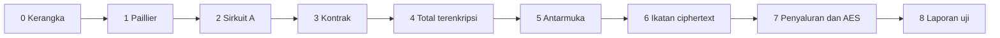

# Rencana pengerjaan

Urutan kerja sampai sasaran tercapai: total kampanye bisa diperiksa publik, nominal tiap donasi tidak tersimpan sebagai plaintext, dan donasi yang tidak sah ditolak.

Acuan perilaku sistem ada di [perancangan-sistem.md](perancangan-sistem.md). Satu tahap selesai hanya jika kriteria di tahap itu lulus. Tahap berikutnya tidak dimulai dengan cara melewati kriteria yang gagal.

Penelitian selesai bila keluaran di tahap 8 ada dan tolok ukur T1 sampai T4 lulus. T5 dilaporkan sebagai perbandingan.

## Tahap 0. Kerangka repositori

Status: selesai. Hardhat test lulus, Circom 2.2.3 dan snarkjs 0.7.6 menjawab, `.env` diabaikan, dan tidak ada dependensi basis data.

Tujuan tahap: satu perintah uji bisa dijalankan, dan rahasia tidak masuk git.

| ID | Pekerjaan | Selesai bila |
|---|---|---|
| 0.1 | Susun folder `circuits/`, `contracts/`, `apps/web/`, `apps/backend/` | Keempat folder ada, masing-masing punya tempat uji |
| 0.2 | Pasang Hardhat, Circom 2, dan snarkjs | `npx hardhat test` berjalan, `circom --version` dan `snarkjs --version` menjawab |
| 0.3 | Pisahkan kunci privat dari repositori | `.env` diabaikan git. Contoh env hanya memuat nama variabel, tanpa nilai kunci |
| 0.4 | Jangan memasang basis data | Tidak ada PostgreSQL, MySQL, MongoDB, atau SQLite untuk donasi. Penyimpanan sistem adalah smart contract, seperti di [teknologi-dan-setup.md](teknologi-dan-setup.md) |

## Tahap 1. Paillier di luar rantai

Status: selesai. Kunci 2048 bit, `Enc(50000)` kembali menjadi 50000, jumlah dengan `Enc(20000)` menjadi 70000, dan nominal di luar 1 sampai 1.000.000.000 ditolak.

Tujuan tahap: penjumlahan homomorfik benar sebelum disentuh blockchain. Ini fondasi T1.

| ID | Pekerjaan | Selesai bila |
|---|---|---|
| 1.1 | Bangkitkan kunci 2048 bit dan enkripsi nominal | `Enc(50000)` bisa didekripsi kembali menjadi 50000 |
| 1.2 | Jumlahkan ciphertext | `Enc(50000) * Enc(20000)` didekripsi menjadi 70000 |
| 1.3 | Uji batas nominal | 0 ditolak. 1 dan 1.000.000.000 diterima. Di atas batas ditolak |

## Tahap 2. Sirkuit tahap A dan verifier

Status: selesai. Proof sah untuk secret yang cocok dan amount 50000. Amount 0 dan secret yang tidak cocok ditolak. Verifier Solidity menerima proof sah dan menolak proof yang diubah. Sinyal publik hanya commitment.

Tujuan tahap: proof membuktikan `Poseidon(secret) = commitment` dan `1 <= amount <= 1000000000`. Amount tetap input privat.

| ID | Pekerjaan | Selesai bila |
|---|---|---|
| 2.1 | Tulis sirkuit Circom dan `circuits/setup.sh` | Setup Powers of Tau `pot12`, Groth16, kurva bn128, menghasilkan `identity.r1cs`, proving key, dan `verification_key.json` |
| 2.2 | Uji witness sah dan tidak sah | Proof sah untuk secret yang cocok dan amount 50000. Proof gagal untuk amount 0 dan untuk secret yang tidak cocok dengan commitment |
| 2.3 | Ekspor verifier Solidity dan uji di Hardhat | Kontrak verifier menerima proof sah dan menolak proof yang diubah |

Amount tidak boleh menjadi sinyal publik. Cek keluaran proof: sinyal publik hanya commitment, belum ciphertext.

## Tahap 3. Kontrak kampanye dan donasi

Status: selesai. Commitment kosong dan ganda ditolak. Dua kampanye uji dibuat pengelola. Donasi menyimpan commitment, ciphertext, pengirim, dan waktu, tanpa field atau event nominal. Commitment yang belum terdaftar ditolak.

Tujuan tahap: rantai menyimpan donasi tanpa field nominal. Registrasi dan status kampanye ditegakkan di kontrak. Agregasi ciphertext menyusul di tahap 4; tahap ini boleh menyimpan ciphertext per donasi dulu.

| ID | Pekerjaan | Selesai bila |
|---|---|---|
| 3.1 | `register(commitment)` | Commitment kosong ditolak. Commitment yang sama tidak bisa didaftar dua kali |
| 3.2 | Data kampanye: judul, target, status aktif, jumlah donasi | Kampanye uji "Bantu Raka kembali bersekolah" target 2.000.000 dan "Bantu Sari pulih setelah operasi" target 5.000.000 bisa dibuat pengelola |
| 3.3 | `donate` menyimpan commitment, ciphertext, pengirim, dan waktu | Tidak ada field `amount`. Event donasi tidak memuat nominal |
| 3.4 | Tolak donasi dari commitment yang belum terdaftar | Uji ini menutup bagian U5 yang tidak bergantung pada isi proof |

## Tahap 4. Total terenkripsi dan dekripsi total

Status: selesai. Dua donasi 50000 dan 20000 dijumlahkan di kontrak. Backend mendekripsi total menjadi 70000. Setelah cache dihapus, pembacaan ulang dari kontrak tetap 70000. Tidak ada fungsi nominal per donasi.

Tujuan tahap: T1 dan T4 bisa diuji di rantai, masih dengan sirkuit tahap A.

| ID | Pekerjaan | Selesai bila |
|---|---|---|
| 4.1 | Kontrak mengalikan ciphertext baru ke `aggregateCiphertext` modulo `n^2` | Dua donasi 50000 dan 20000 mengubah ciphertext total |
| 4.2 | Backend membaca ciphertext total dari kontrak dan mendekripsi dengan kunci privat | Hasilnya 70000. Tidak ada endpoint yang mengembalikan nominal per donasi |
| 4.3 | Hapus state backend, dekripsi ulang dari kontrak | Angka total tetap 70000. Ini U8 |

## Tahap 5. Antarmuka alur donasi

Status: selesai. Di browser lokal, kampanye kosong menampilkan "belum dihitung", identitas terdaftar, donasi 50.000 lalu 20.000 membuat total Rp 70.000, dan riwayat berisi dua baris `ENC` tanpa nominal.

Tujuan tahap: satu donasi 50.000 bisa diselesaikan dari browser, dan riwayat tidak menampilkan nominal.

| ID | Pekerjaan | Selesai bila |
|---|---|---|
| 5.1 | Daftar kampanye, status, dan total atau tulisan "belum dihitung" | Kampanye tanpa donasi menampilkan "belum dihitung" |
| 5.2 | Registrasi secret di browser | Layar menampilkan "Identitas terdaftar. Siap berdonasi." Secret tidak dikirim ke server |
| 5.3 | Formulir donasi | Jumlah diberi keterangan "akan dienkripsi". Secret disamarkan. Status berurutan: enkripsi Paillier, proof snarkjs, kirim ke blockchain, tunggu konfirmasi |
| 5.4 | Layar sukses dan riwayat | Sukses menampilkan pengenal transaksi dan kalimat bahwa donasi tercatat terenkripsi. Baris riwayat berisi `ENC`, tanpa angka 50000 |
| 5.5 | Donasi kedua 20.000 | Total kampanye menjadi 70.000. Riwayat bertambah satu baris `ENC` |

## Tahap 6. Ikatan ciphertext

Tujuan tahap: T3 tercapai. Proof hanya sah jika ciphertext adalah enkripsi Paillier dari `amount` yang dirahasiakan.

| ID | Pekerjaan | Selesai bila |
|---|---|---|
| 6.1 | Perluas sirkuit: input publik mencakup limb ciphertext; input privat mencakup randomness `r`; batasan `c = g^amount * r^n mod n^2` | Proof sah untuk pasangan amount dan ciphertext yang benar |
| 6.2 | Hubungkan verifier baru ke `donate` | Sinyal publik proof sama dengan ciphertext yang disimpan |
| 6.3 | Uji U4 | Proof yang amount-nya 50000 tetapi ciphertext-nya enkripsi angka lain ditolak kontrak |
| 6.4 | Uji U6 pada sirkuit baru | Amount 0 tidak menghasilkan proof |

Jika 6.1 terlalu berat untuk satu putaran, pecah menjadi bukti rentang yang sudah ada di tahap A dan bukti hubungan Paillier. Keduanya wajib lulus sebelum tahap 7. Tahap 5 yang masih memakai sirkuit A tetap sah sebagai jejak kemajuan, tetapi belum memenuhi T3.

## Tahap 7. Penyaluran dan pembanding AES

Tujuan tahap: U7 dan T5.

| ID | Pekerjaan | Selesai bila |
|---|---|---|
| 7.1 | `markDisbursed` hanya bisa dipanggil pengelola | Status menjadi tersalurkan, waktu tercatat, donasi baru ditolak. Ini U7 |
| 7.2 | Contoh kampanye Sari | Total 5.000.000, target 5.000.000, status tersalurkan, tanggal 27 Juli 2026, keterangan dana sudah ditransfer |
| 7.3 | Jalur AES untuk skenario yang sama dengan U1 | AES menyimpan atau membuka 50000 dan 20000 agar bisa menjumlahkan. Paillier tidak menulis kedua angka itu ke rantai. Ini U10 |

## Tahap 8. Uji akhir dan laporan

Tujuan tahap: menutup sasaran. Tidak ada fitur baru di tahap ini.

| ID | Pekerjaan | Selesai bila |
|---|---|---|
| 8.1 | Jalankan U1 sampai U10 | U1–U9 lulus. U10 terlaporkan |
| 8.2 | U9, sepuluh nominal berbeda | Total dekripsi sama dengan jumlah kesepuluh nominal |
| 8.3 | Catat waktu enkripsi, waktu proof, gas `donate`, dan gas pembaruan ciphertext total | Empat angka itu tertulis di laporan untuk minimal satu donasi di jaringan lokal. Tidak ada ambang lulus |
| 8.4 | Tulis `docs/laporan-uji.md` | Berisi tabel T1–T5, tabel U1–U10, tabel waktu dan gas, serta daftar keluaran: spesifikasi, kunci bukti, kontrak, aplikasi |

## Urutan dan ketergantungan

Tahap 5 boleh dikerjakan bersamaan dengan tahap 4 setelah `donate` di tahap 3 menyimpan ciphertext. Tahap 6 tidak boleh dilewati: tanpa ikatan ciphertext, T3 gagal.

## Definisi selesai

| Tolok ukur | Ditutup di |
|---|---|
| T1 Kebenaran total | 4.2 dan 8.2 |
| T2 Privasi catatan | 3.3 dan 5.4 |
| T3 Penolakan masukan tidak sah | 3.4, 6.3, 6.4, dan 7.1 |
| T4 Total tidak bergantung pada basis data | 4.3 |
| T5 Pembanding AES | 7.3 |
| Kelima keluaran penelitian | 8.4 |
